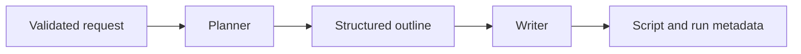

# Stage 2 — Planner and Writer with LangGraph

## What changed

Stage 1 only checked input. Stage 2 adds `POST /api/stories/generate`: it runs two distinct agent steps and returns an outline and a scene-based script. Google Gemini supplies live model responses. The default demo provider supplies clearly labelled fixed sample data for offline exploration.

The evaluation judge and feedback-based rewrite come next. This stage returns an unevaluated draft and stores nothing in a database.

## Follow the workflow



`workflow.py` defines a LangGraph `StateGraph`. State is the shared data passed between nodes: request, outline, script, and usage. Edges explicitly connect START → planner → writer → END.

The Planner uses its own versioned prompt to create characters, setting, conflict, and scene beats. The Writer receives both the original request and the validated outline. It writes narration and dialogue while preserving character names and scene count. These are two specialized generation steps using the same model, not two independently trained models.

`providers.py` handles Gemini communication. Keeping it separate means the graph does not need to know SDK details. `generation_models.py` defines the structures expected from the model; malformed responses never become successful drafts. `prompts.py` records the instructions and version returned in every run.

## Run the offline demo

From the repository root, update dependencies with the README commands. The default is `STORY_PROVIDER=demo`. Open `/docs` and send the README example to `POST /api/stories/generate`.

The response includes `is_demo: true`, `model: fixed-fixture-v1`, and a warning. It contains a short fixed story about Mira and a lost letter. It deliberately ignores the requested premise, language, tone, and length; it verifies plumbing, not creative quality. A Gemini failure never silently switches to demo mode.

## Enable real Gemini generation

Copy `.env.example` to `.env` once. In a local editor, set:

```dotenv
STORY_PROVIDER=gemini
GEMINI_API_KEY=your_key_here
GEMINI_MODEL=your_available_model_id
```

Use a model available in your Google AI Studio account that supports structured JSON output. Obtain credentials through [Google AI Studio](https://aistudio.google.com/). Do not paste your key into a chat, commit, screenshot, or README. `.env` is ignored by Git. Environment variables override `.env`; restart the server after changing configuration.

Each successful live request makes two generation calls. Each call has a 60-second HTTP timeout, one total SDK attempt (no automatic retries), and a 12,000 output-token cap. The whole workflow has a 150-second deadline. Token limits and requested word count are different; output length is approximate. Your provider's billing and quota rules apply.

## Read the response

| Field | Meaning |
| --- | --- |
| `outline` | Planner's title, setting, characters, conflict, and scene beats |
| `script` | Writer's structured scenes, narration, and dialogue |
| `final_text` | A plain-text rendering of the script |
| `usage` | Step timing and token counts when provided by Gemini |
| `run_id` | A unique identifier for this response; not a stored project ID |
| `prompt_version` | The version of the generation instructions |
| `is_demo`, `provider`, `model` | Whether this used fixed fixtures or Gemini |
| `warnings` | Demo limitations or the lack of quality evaluation |

## Error behavior and checks

Invalid user input returns 422 before creating a provider. Missing configuration returns 503; quota/rate limits return 429; timeouts return 504. Blocked, truncated, malformed, or inconsistent model output returns a safe 502 error. Raw provider error details and secrets are not returned to the caller.

Tests run the real LangGraph with fixed provider responses, verify that the Writer receives the Planner's output, and cover configuration, malformed JSON, incomplete output, unknown characters, quota errors, and timeout cleanup. Gemini SDK calls are mocked during tests, so passing tests do not establish live model quality or account access.

Checkpoint verification: 35 tests passed, including a real Gemini SDK serialization/parsing check using mocked HTTP transport. Ruff lint and format checks passed, and `pip check` found no broken requirements. No live Gemini request was made because a local API key and model were not configured.

This API is for local development. It has no authentication, durable jobs, persistence, or public rate limiting yet. Keep it bound to localhost until those deployment concerns are addressed.

## GitHub checkpoint

Stage 1 is on `main`. Stage 2 is developed on `codex/stage-2-planner-writer`, preserving that first public milestone. Review this stage, configure Gemini locally, and try a live request before publishing the next milestone.

After the Stage 2 commit exists, you can publish its branch:

```powershell
git push -u origin codex/stage-2-planner-writer
```

Then review and merge it through a GitHub pull request when you are ready. The next stage adds a rubric-based judge and at most one feedback-driven rewrite.

## References

- [LangGraph Graph API](https://docs.langchain.com/oss/python/langgraph/graph-api)
- [Google Gen AI Python SDK](https://github.com/googleapis/python-genai)
- [Gemini structured output](https://ai.google.dev/gemini-api/docs/generate-content/structured-output)
