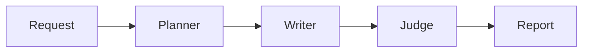

# Stage 3 — LLM-as-a-judge evaluation

Stage 2 generates a draft. Stage 3 adds a separate evaluation call after the Writer. The same Gemini model judges the script using a different prompt; this is not an independently trained model or an objective quality guarantee.

## Follow the data



The judge receives the original request, the outline, and the script. It returns five required ratings, each with a 1–10 integer score, explanation, concrete evidence, and supporting scene numbers. Higher is always better, including `repetition_avoidance`.

The dimensions are narrative coherence, character consistency, repetition avoidance, language quality, and instruction adherence. The report also includes a summary and 1–5 actionable revision suggestions.

`generation_models.py` validates the assessment. Missing dimensions, fractional or out-of-range scores, and missing evidence are rejected. `evaluation.py` checks that cited scene numbers exist and computes the equally weighted average in Python. The model does not control its own overall score or threshold.

An average below 7.0 OR any individual dimension below 4 sets `needs_revision: true`. Otherwise no revision is recommended. An average of exactly 7.0 and a minimum score of exactly 4 pass. This is only a recommendation in Stage 3. No rewrite happens until Stage 4. The individual score floor prevents a strong average from hiding a severely weak dimension.

## Try it

Use the README startup command and submit a story to `POST /api/stories/generate` in `/docs`. The existing response now includes `evaluation`:

```json
{
  "rubric_version": "story-quality-v1",
  "overall_score": 6.4,
  "revision_threshold": 7.0,
  "needs_revision": true
}
```

This excerpt omits the nested `assessment` for brevity. In demo mode the five scores are fixed at 7, 8, 8, 7, and 2, averaging 6.4. They are sample data, not measured performance. Demo mode never evaluates the user's premise. Gemini mode makes three calls: Planner, Writer, and judge.

Each model call retains its 60-second timeout, one total SDK attempt, and 12,000 output-token cap. The overall deadline is now 210 seconds for three steps. The `usage` array includes evaluator latency and token usage when available. There is no automatic retry or revision.

## Failure behavior and limitations

A failed or invalid judge response fails the request with an error rather than returning a successful result with fabricated scores. No draft is persisted, so a failed request's intermediate script is not retrievable yet. Existing provider error handling and client cleanup apply to the judge too.

The judge prompt treats story text as material to assess, not instructions to obey. This reduces prompt-injection risk but does not guarantee resistance. Scene numbers are validated; the truth of quoted or paraphrased evidence is not automatically verified. Language, story quality, and approximate length remain model judgments. Using the same model for writing and judging can introduce correlated biases.

## Review consistently

Use `docs/evaluation-cases.json` as a small manual review set. Run the same requests after prompt changes, save outputs outside Git if they contain private content, and compare evidence and revision suggestions against the listed criteria. These are review criteria, not guaranteed scores. Do not compare demo scores as if they measure prompt quality.

## Git checkpoint

Verification: 51 automated tests passed, including Gemini SDK schema serialization and parsing with mocked HTTP responses. Ruff lint and formatting checks passed. No live Gemini quality evaluation was performed; that requires your configured account and model.

Stage 2 is published on `codex/stage-2-planner-writer`. Stage 3 is committed locally on `codex/stage-3-evaluator`, based on Stage 2. To publish this milestone when ready:

```powershell
git push -u origin codex/stage-3-evaluator
```

For a focused pull request, compare Stage 3 against the Stage 2 branch. If Stage 2 is already merged into `main`, use `main` as the base. The next milestone applies judge feedback in one bounded rewrite and evaluates the revised draft again.
