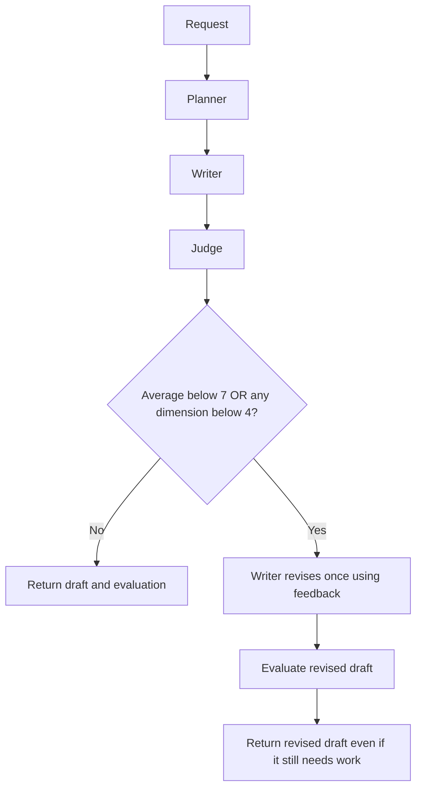

# Stage 4 — One feedback-based rewrite

The core AI flow now plans, writes, evaluates, and conditionally rewrites the story once. It reuses the Writer role with a dedicated revision prompt, not a third generation agent.



## What the Writer receives

The revision call receives the original request, unchanged outline, complete previous script, and the judge's full report including scores, evidence, and suggestions. It returns a full replacement script. The same structural checks enforce title, scene count, and character names for both initial and revised drafts.

The final judge receives the original request, outline, and revised script. Previous scores are deliberately omitted to reduce anchoring. It uses the same rubric and recommendation rule as the first judge.

## Why the workflow cannot keep rewriting

LangGraph routes the initial evaluation either to END or to a revision node. Revision leads to final evaluation, which always leads to END. There is no edge back to revision. A passing draft makes three model calls; a draft requiring revision makes five, at most. SDK retries remain disabled.

The combined rule is: average below 7 OR any dimension below 4 recommends revision. Exactly 7 average and a minimum dimension score of 4 pass. The recommendation is recomputed for the revised script but cannot initiate a second rewrite in this run.

## New response fields

| Field | Meaning |
| --- | --- |
| `initial_script` | Original draft, retained for comparison |
| `initial_evaluation` | Judge report used to decide whether to rewrite |
| `script`, `evaluation`, `final_text` | Final draft and its own evaluation; revised output when a rewrite occurred |
| `revision_count` | 0 or 1 |
| `stop_reason` | `quality_passed` or `revision_limit_reached` |
| `revision_prompt_version` | Version of the feedback-based writing prompt |
| `usage` | All executed steps, including revision and final evaluator when used |

`status: completed` means execution finished, not that the story passed the rubric. `revision_limit_reached` explicitly means the revised draft still triggers the recommendation rule. A revision is not guaranteed to improve quality; even a lower-scoring rewrite is returned with both versions visible. There is no hidden selection of the better-scoring draft.

## Try it and inspect the result

Start the API with the README command and use `POST /api/stories/generate` in `/docs`. In demo mode the original sample has an average of 6.4 and a dimension score of 2, so it follows the revision branch. The fixed revised sample adds a sentence, and the fixed assessment remains unchanged. The result therefore has `revision_count: 1` and `stop_reason: revision_limit_reached`. This is a plumbing demonstration, not an actual quality improvement or live judgment.

For Gemini, configure your local `.env` as described in Stage 2. No new dependency or credential is needed. The full workflow deadline is 330 seconds; each call retains its 60-second HTTP timeout and 12,000 output-token cap. Additional calls increase usage and may incur costs under your account's provider terms.

## Failures and remaining limits

If the rewrite or final judgment fails, the request returns an error and closes the provider client. No partial successful response or fabricated final evaluation is returned. Drafts are still in memory only, so intermediate work cannot be retrieved after a failed request. The API remains for localhost use until authentication and deployment safeguards are added.

The test suite exercises passing drafts, both revision triggers, exact threshold boundaries, feedback handoff, final-judge inputs, preservation of the original draft, failed rewrites, invalid revised characters, worse final scores, and the one-rewrite limit. Tests use mocks/fixtures; live Gemini quality remains a separate manual check with the evaluation cases.

## Git checkpoint

Checkpoint verification: 71 automated tests passed, along with Ruff lint and formatting checks. Tests include real Gemini SDK serialization with mocked HTTP transport, but no live Gemini quality or improvement claim has been verified.

Stage 3, including the individual-dimension rule, is published on `codex/stage-3-evaluator`. Stage 4 is developed on `codex/stage-4-feedback-revision` and stays local until you publish it:

```powershell
git push -u origin codex/stage-4-feedback-revision
```

Compare the branch against Stage 3 for a focused review, or against `main` after previous stages are merged. The next planned stage is PostgreSQL persistence for projects, drafts, evaluations, and run history.
