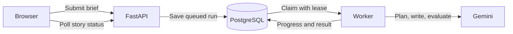

# Stage 8 — Background jobs and progress tracking

Previously, a saved-story request stayed open while Gemini planned, wrote, and evaluated the story. The API now saves a queued run and returns HTTP **202 Accepted** immediately. A separate Python worker reads the queue, generates the story, and saves the result. The browser polls the existing authenticated story endpoint and displays the current stage.



## The flow

1. The signed-in user submits a brief. FastAPI saves the project and queued run in one transaction, using the verified owner.
2. The browser receives the story ID and opens `/?story=<id>`. Refreshing this URL reloads the saved job; it does not submit another generation request.
3. A worker claims one eligible run with `FOR UPDATE SKIP LOCKED`, commits the claim, and releases the database transaction before calling Gemini.
4. LangGraph reports planning, writing, evaluating, optional revising and final evaluation. These are actual stage changes, not a simulated percentage or an estimated completion time.
5. The worker saves drafts, evaluations, and the final output atomically. The browser switches to the completed story automatically.

PostgreSQL documents `SKIP LOCKED` as useful for multiple consumers of a queue-like table: [SELECT locking clauses](https://www.postgresql.org/docs/current/sql-select.html). This project reuses PostgreSQL instead of adding a separate queue service.

## Failure and recovery rules

- A claim has a random token and a 90-second lease. The worker renews it every 15 seconds.
- If the process stops, another worker can reclaim the run after the lease expires. Progress and final writes require the current token and a live lease, so a stale worker cannot overwrite the new attempt.
- Recovery restarts the whole workflow. Intermediate agent outputs are not checkpointed. A provider call may have been billed before a crash, so recovery can repeat model calls; this is not exactly-once model execution.
- Temporary connection, rate-limit, and timeout errors retry after 15 then 30 seconds, for at most three total attempts. Configuration errors, invalid outputs, and other failures become terminal.
- If the third attempt loses its worker, the next worker poll marks it failed. Jobs remain queued while no worker is running. A stopped worker does not mean a job was lost.
- Duplicate regeneration requests for the same story reuse its active background run. Separate new-story POST requests can still create separate projects; do not blindly resubmit after a network error—check the library first.
- The existing one-rewrite quality policy is unchanged. Retrying a failed execution and revising a low-scoring story are different operations.
- The worker polls every two seconds while idle. An always-running worker can keep a cloud database awake and consume compute. Public deployment, usage limits, and durable per-node checkpoints remain later work.

## Run locally

Use the existing ignored root `.env` for PostgreSQL, Gemini, and Clerk. Stop older API/worker processes before upgrading. From the repository root:

```powershell
$env:PYTHONUTF8 = '1'
$env:PYTHONPATH = (Resolve-Path backend/src).Path
.\.venv\Scripts\python.exe -m story_api.database
```

This applies schema version **3**. It adds queue fields and an index while preserving existing projects, ownership, drafts, evaluations, and output. Legacy runs keep their original expiration behavior. Migration is explicit, transactional, and repeatable; workers do not migrate automatically.

Start the API in one terminal:

```powershell
$env:PYTHONUTF8 = '1'
.\.venv\Scripts\python.exe -m uvicorn story_api.main:app --app-dir backend/src --host 127.0.0.1 --port 8000
```

Start the worker in another terminal:

```powershell
$env:PYTHONUTF8 = '1'
$env:PYTHONPATH = (Resolve-Path backend/src).Path
.\.venv\Scripts\python.exe -m story_api.worker
```

Run `npm run dev` from `frontend/` in a third terminal and open http://localhost:3000. The existing frontend environment still works. Stop processes with Ctrl+C. A worker requires an always-running Python process; a short-lived serverless request is not its host.

## API and frontend changes

`POST /api/stories` and `POST /api/stories/{id}/runs` now return **202**, with the same story envelope but an initially queued `latest_run`. Clients must fetch `GET /api/stories/{id}` for completion. Runs expose `stage`, `attempt`, and `available_at`; lease tokens stay private. The old `/api/stories/generate` endpoint remains synchronous and stateless for direct experiments.

The frontend polls an open active story roughly every two seconds, waits for each response before scheduling another, and backs off to 30 seconds on connection failures. It aborts polling when the reader unmounts or the session changes. The URL contains only the story ID; authorization still comes from the verified Clerk token. Editor inputs and regeneration are disabled during active generation, while navigation remains available. Existing manual edits remain separate from generated output.

## Files to understand

| File | Responsibility |
| --- | --- |
| `backend/src/story_api/jobs.py` | Claim, lease renewal, progress, bounded retries |
| `backend/src/story_api/worker.py` | Worker loop, model execution, heartbeat and cleanup |
| `backend/src/story_api/workflow.py` | Progress callbacks around real graph nodes |
| `backend/src/story_api/storage.py` | Queued runs, duplicate regeneration protection, fenced completion |
| `backend/src/story_api/database.py` | Version 3 migration |
| `frontend/src/components/run-progress.tsx` | Stage labels and recovery explanation |
| `frontend/src/components/story-reader.tsx` | Polling and automatic result display |
| `frontend/src/components/studio.tsx` | Reopen a story after page refresh |

## Verification

Final checkpoint: 116 backend tests passed with isolated PostgreSQL, six frontend tests passed, TypeScript checking passed, and the Next.js production build passed. Ruff lint and formatting checks passed.

The PostgreSQL suite covers concurrent claims, duplicate regeneration, expired-lease recovery, rejection of stale writes, retry delays and limits, abandoned final attempts, real graph progress, migration preservation, atomic output, and cross-user isolation. Tests use uniquely named disposable schemas; never point test commands at a database without permission to create and drop test schemas.

For a manual check, leave the worker stopped, submit a story, and refresh the page while it is queued. Start the worker and watch progress. Navigate to the library and reopen the story; it should finish independently of the browser. To exercise crash recovery without Gemini costs, use demo mode in an isolated environment.

Live verification on November 6, 2026: the real Clerk session submitted a queued job to Neon with the worker stopped. The story reopened after a page refresh and from the personal library. Starting the worker produced Gemini's "The Librarian of Foreshadowed Pages" with an 8.4/10 evaluation, and polling displayed the result automatically. Migration version 3 was applied to Neon. Worker shutdown/reclaim behavior was exercised separately with an isolated PostgreSQL database and a blocked test provider.

A refresh initially encountered a transient 401. Reads now retry once with a fresh Clerk token; mutations are never replayed by that helper. Tests cover both the successful refresh and the retry bound. No authentication validation was relaxed.
